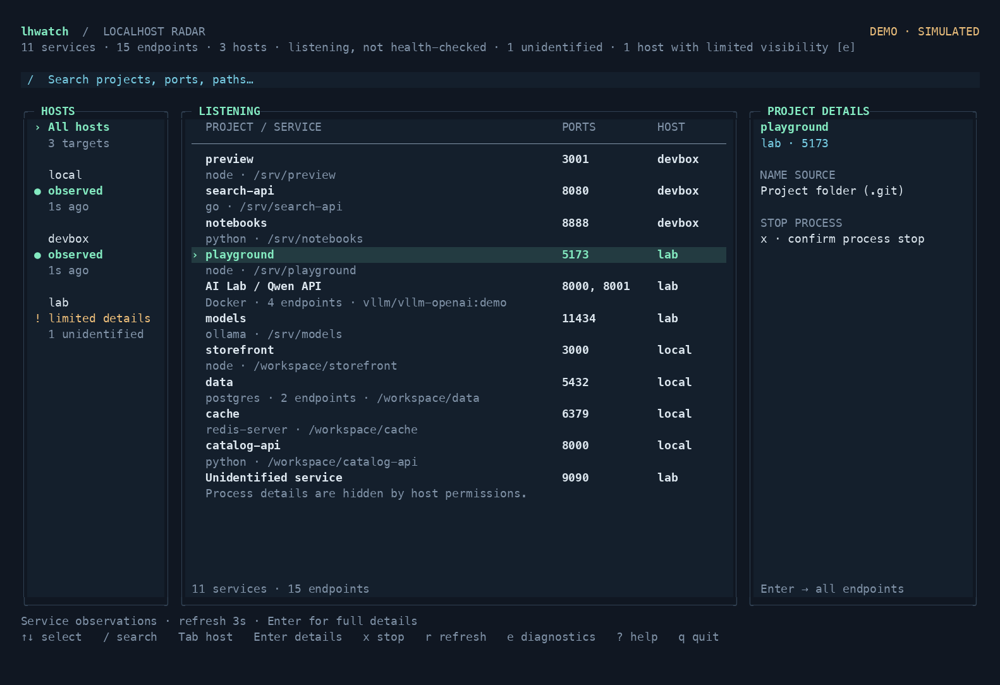
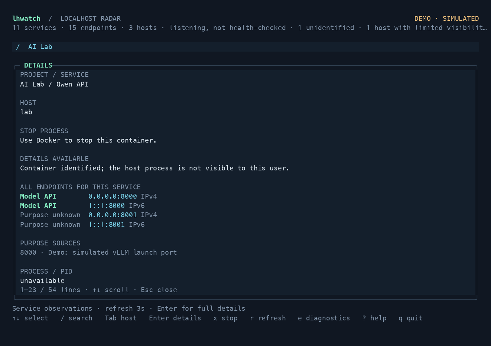
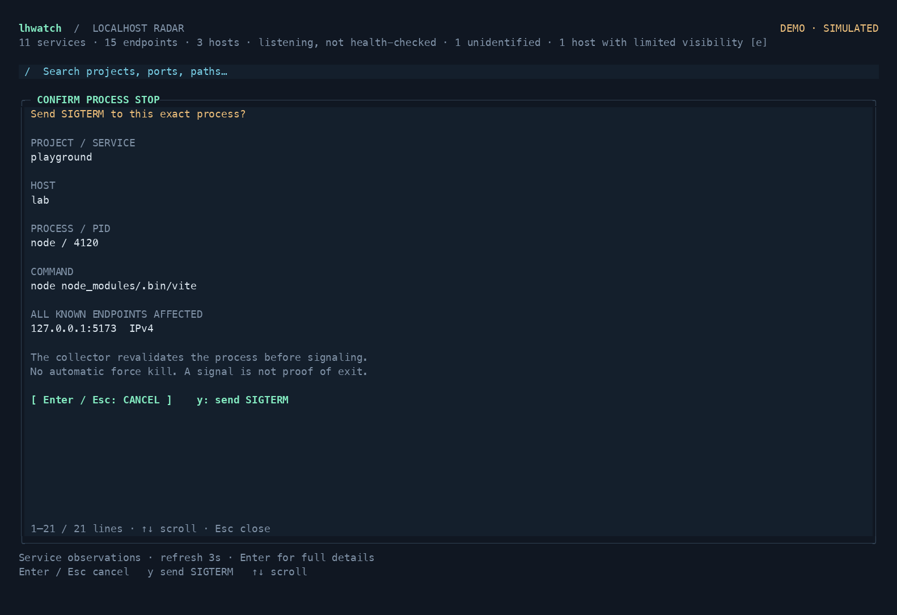

# lhwatch

**Your localhost, everywhere.** A Bubble Tea dashboard for the TCP servers running on your Mac, Linux machine, and SSH hosts.

See named services and their ports, filter across machines, inspect a process, and request a graceful stop without switching terminals. Each host refreshes independently; a disconnected machine stays visibly disconnected.



## Requirements

Requires **Go 1.26+ to build**, **Python 3.9+ on each monitored machine**, and a terminal. macOS uses the system `lsof` and `ps`. Linux uses `/proc`. Remote monitoring uses your existing OpenSSH client, keys, agent, and SSH configuration.

## Install

With Go:

```sh
go install github.com/joeynyc/lhwatch@latest
```

From source:

```sh
git clone https://github.com/joeynyc/lhwatch && cd lhwatch && go build -trimpath -o bin/lhwatch .
./bin/lhwatch
```

From a release: download the archive for your platform from the repository's **Releases** page, or with the GitHub CLI:

```sh
gh release download --repo joeynyc/lhwatch --pattern '*darwin_arm64.tar.gz' --pattern SHA256SUMS
shasum -a 256 --check --ignore-missing SHA256SUMS
```

Extract the archive and move `lhwatch` onto your `PATH`. Archives are published for `darwin_arm64`, `darwin_amd64`, `linux_arm64`, and `linux_amd64`; ARM64 Linux machines such as an NVIDIA DGX Spark use `linux_arm64`. If `gh` isn't installed on a machine, download the archive elsewhere and copy it over with `scp`. A binary downloaded through a browser on macOS may need `xattr -d com.apple.quarantine lhwatch` because releases are not code-signed.

The examples below assume `lhwatch` is on your `PATH`; use `./bin/lhwatch` if you built from source.

## Try the demo

Try the built-in fleet without connecting to any machines:

```sh
lhwatch --demo
```

The demo is entirely simulated, including stop actions. It ignores host configuration and never contacts or signals real services.

## Add an SSH host

First establish a normal SSH connection so your key and the server's identity are known:

```sh
ssh you@devbox
```

Then monitor it alongside this machine:

```sh
lhwatch --host devbox=you@devbox
lhwatch --host devbox=you@devbox --host gpu=you@gpu-box
```

Names on the left of `=` are dashboard labels. The destination may be an existing SSH alias, including aliases created by tools such as NVIDIA Sync; there is no need to copy keys or configure another login. The app uses noninteractive authentication and strict host-key checking; it never prompts for a password, accepts an unknown server key, installs a daemon, or changes your SSH configuration. Keep password-protected keys loaded in your SSH agent.

While the dashboard runs, it reuses one SSH connection per host through OpenSSH connection sharing instead of reconnecting on every refresh. Control sockets live in a private per-user directory (`$XDG_RUNTIME_DIR/lhwatch-UID`, or `/tmp/lhwatch-UID` when `XDG_RUNTIME_DIR` is unset, as on macOS); if that directory is shared, foreign-owned, or a symlink, reuse is disabled. The connections close when the dashboard exits, or on their own after 60 idle seconds if it is interrupted. `--json` snapshots connect independently.

To run the dashboard **on a Linux host**, install the matching binary there (or build one with `make cross`, which writes `dist/lhwatch-linux-arm64`, `dist/lhwatch-linux-amd64`, and the macOS binaries), and run it from a terminal. Its local view then describes that machine. Configure other hosts—including a Mac with SSH access enabled—in the same way.

## Configuration

By default, lhwatch reads `$XDG_CONFIG_HOME/lhwatch/config.json`, or `~/.config/lhwatch/config.json` if that variable is unset. A missing default file is fine. An explicit `--config` path must exist and be valid.

```json
{
  "refresh_seconds": 3,
  "timeout_seconds": 8,
  "hosts": [
    { "name": "laptop" },
    { "name": "devbox", "ssh": "you@devbox" },
    { "name": "gpu", "ssh": "you@gpu-box", "port": 2222, "identity_file": "~/.ssh/id_ed25519" }
  ]
}
```

A host without `ssh` represents the machine running the TUI. If omitted, one named `local` is added. Configure at most one local entry. SSH entries can also set `port` and `identity_file`; `~/` is expanded in the identity path. Names must be unique.

```sh
lhwatch --config lhwatch.example.json
lhwatch --refresh 2 --timeout 5
```

Configuration order is defaults, file, then flags. Repeatable `--host` entries **add** hosts; duplicate names are errors rather than silent replacements. Refresh is 1–3600 seconds; each host timeout is 1–60 seconds. Personal configurations can be saved as `*.local.json`, which Git ignores.

## Clear project names

The main list leads with the **project or application name**, with its process, folder, or Docker context underneath. Endpoints belonging to one verified process or container share a row. Multiple ports appear together; `3000 +4` means four more ports are available in details. Search matches the whole service, so searching one port still lets you inspect all its endpoints. Identified services appear before unidentified listeners. PID and full command remain in details.

On each monitored host, lhwatch walks upward from the process working directory (up to 16 levels). At the nearest matching directory it uses:

1. A custom name from `.lhwatch.json`.
2. The `name` in `package.json`.
3. The folder containing `.git`, `go.mod`, `pyproject.toml`, or `Cargo.toml`.

It skips dependency folders inside `node_modules` or virtual environments, including when inferring a project folder without metadata. The search stops before shared system directories and standard Homebrew prefixes, so Homebrew's own repository does not become a service's project name. Invalid, oversized, or excessively nested metadata is ignored without losing the host's listeners.

If no project marker is found, it can recognize a macOS app bundle from the process's executable path, or show a working-directory name explicitly marked **folder inferred**. App paths appearing only in command arguments do not count. Otherwise it keeps the process name and says **project unidentified**. Details show the naming source and full folder so ambiguous names are traceable. No project code is executed, and ports are never used to guess project names.

For a name you recognize instantly, create `.lhwatch.json` in the project folder **on the machine running that server**:

```json
{"name": "My Store Website"}
```

The name appears on the next refresh. In a monorepo, the nearest package or project marker wins; place the custom name in that package directory. Missing permissions or unavailable working directories can prevent attribution. Names are display metadata; stopping still revalidates the actual process and listener.

Processes inside Docker, Podman, containerd, CRI-O, Kubernetes, and LXC containers are recognized from their cgroups and cannot be stopped from lhwatch. When Docker is available through a local Unix socket, lhwatch also adds container names and Compose project/service labels. For Linux containers using host networking, it matches actual socket ownership inside the container to the host listener. That inspection needs Python 3 and readable process descriptors inside the container. It uses the container's existing permissions. Containers sharing a PID namespace cannot be attributed this way, and an incomplete container inventory leaves host-network names unavailable. Published TCP ports can be named from an exact, unique Docker binding.

Docker naming is optional and time-limited. Missing Docker access leaves ordinary listener discovery available. Root or system services without sufficient naming evidence remain **Unidentified service**, with a nearby explanation. **Limited details** means the host was observed but some information could not be read. Container rows explain that their stop controls belong in Docker; this release only stops verified ordinary processes.

## Endpoint purposes

Open a service's details to see purpose labels to the left of each address. **Model API**, **Web UI**, or another explicit label describes that endpoint; **Purpose unknown** means lhwatch has no evidence for its role. The **PURPOSE SOURCES** section explains where each label came from.



On macOS or Linux, declare endpoint purposes in the project's `.lhwatch.json` on the machine running the server:

```json
{
  "name": "My Store Website",
  "endpoints": {
    "3000": "Web UI",
    "8000": "API"
  }
}
```

Mappings apply to exact TCP port numbers for that discovered project. They take precedence over automatic labels and appear on the next refresh. Use the nearest project directory described above.

On Linux, lhwatch also recognizes explicit launch ports in supported SGLang, vLLM, and Python `http.server` commands. Verified host-network Docker containers can use the same evidence, including NVIDIA's entrypoint wrapper. Labels describe the declared launch purpose, not a health check. Ambiguous commands, unreadable arguments, auxiliary ports, and published Docker port translations remain unknown. lhwatch never guesses a purpose from a familiar port number, image name, or address, and it does not send requests to your servers.

Detected container processes do not borrow purpose mappings from identically named folders on the host; their automatic labels use launch evidence.

## Keys

| Key | Action |
| --- | --- |
| `↑` / `↓`, `k` / `j` | Select a service |
| `/` | Search names, commands, hosts, ports, and directories |
| `Enter` while searching | Keep the filter and return to navigation |
| `Esc` | Cancel a dialog or clear the filter |
| `Tab` / `Shift+Tab` | Cycle host filters |
| `Enter` | Inspect all endpoints, identity evidence, and available actions |
| `o` | Open the service in a browser, through an SSH tunnel for remote hosts |
| `O` | Close the selected service's SSH tunnel |
| `x` | Review a stop confirmation |
| `y` inside confirmation | Request SIGTERM for the displayed process |
| `n`, `Esc`, or `Enter` inside confirmation | Cancel; no signal |
| `r` | Refresh |
| `e` | Inspect host errors and warnings |
| `?` | Keyboard help |
| `q` / `Ctrl+C` | Quit |

The mouse works too: click a service to select it and click it again for details, click a host to filter by it, use the wheel to move or scroll, and click the footer hints. Clicking the header closes a panel. A click never sends a signal; confirming a stop always needs `y`. While lhwatch has the mouse, select text by holding Option in iTerm2, Shift in most other terminals, or Fn in macOS Terminal (where Command-R also toggles mouse reporting). Or run with `--no-mouse`. In kitty, Ghostty, foot, and recent iTerm2, lhwatch also shows an arrow pointer instead of the text I-beam (via the OSC 22 escape sequence) and restores the terminal's pointer on exit; other terminals ignore the request.

The layout adapts to the terminal. A wide window gives you the most context; details remain accessible in narrower windows. External names, commands, and errors are sanitized before rendering.

## Open a service

Press `o` on a service to open it in your browser. A service with several ports opens its **Web UI** endpoint if one is labelled, otherwise another labelled endpoint, otherwise its lowest port. Local services open directly. URLs use `http://`; lhwatch never guesses HTTPS from a port number.

For a remote host, lhwatch forwards the port over SSH and opens the forwarded address, so a remote web UI is one key away. The forward binds only to `127.0.0.1` on this machine and uses the same port number when it is free, or another free port. All tunnels to one host share a dedicated SSH connection that ignores port forwards in your SSH configuration. Details and diagnostics (`e`) list open tunnels. `O` closes one; quitting closes them all. Other local users can reach a forwarded port while it is open, as with `ssh -L`.

A browser is launched only where it can appear: `open` on a Mac you are sitting at, or `xdg-open` when Linux has a graphical display. Over SSH or without a display, lhwatch shows the URL and sends it to your terminal's clipboard (OSC 52, where supported). The demo simulates tunnels and never opens a browser.

## What “stop” means

A port belongs to a process. Stopping that process can close **all of its listeners**, not just the highlighted endpoint. The confirmation names the machine, process, PID, and its known listening endpoints.



Before signaling, the collector checks the process's identity, ownership, and selected listener again on that machine. It refuses unknown, stale, changed, protected, or foreign-user targets. When Docker is reachable, it also rechecks published port bindings and refuses a process that forwards ports for a container, such as a rootless Docker port proxy, or whose container ownership is ambiguous. If Docker lists its containers but they cannot all be inspected (more than 64 are running, or the scan time limit is reached), ordinary processes are not stoppable until a complete inventory is available. On Linux, a process whose container membership cannot be read is refused. Linux uses a pidfd when available to bind the signal to that process incarnation. macOS and fallback Linux signaling retain a small check-to-signal race; PID reuse protection is best-effort there.

The action sends **SIGTERM only**. “Requested” means the signal was sent; the next scan establishes whether the listener disappeared. A process may ignore SIGTERM or be restarted by its supervisor. There is no automatic SIGKILL or process-tree termination. Container groups do not offer process stopping, because a container can contain several processes and have its own lifecycle manager. If the response is lost, the outcome is shown as unknown and the host is refreshed; a connection error does not prove that no signal was sent.

## Visibility

- This release discovers **listening TCP sockets**, including loopback, wildcard, IPv4, and IPv6. It does not call a listening socket “healthy.” UDP, application logs, and AI/GPU metrics are outside this first version.
- Collection runs with the logged-in user's permissions. macOS may omit other users' sockets; Linux may show a listener without enough information to identify its process. Unknown ownership disables stopping.
- A host scan sees its current network namespace. Ports published by containers may appear, but isolated container listeners and Docker Desktop's internal VM are not universally visible. The app does not claim to discover every container service.
- One service row can contain several addresses or ports. Grouping requires a shared process incarnation or container ID on the same host; identical project names alone never combine processes. Unidentified endpoints remain separate.
- Failed hosts retain their last observations in the TUI as stale and cannot be stopped from that stale view. JSON reports the failed scan explicitly rather than silently returning success.

## Read-only JSON

```sh
lhwatch --json
lhwatch --host devbox=you@devbox --json
lhwatch --demo --json
```

Output contains `schema_version`, `collected_at`, and an ordered `hosts` array. Each host includes its services, collection time, platform, visibility warnings, and any error. A host whose scan failed has an `error` and empty `services`, and omits `collected_at` and `platform` rather than reporting placeholder values. This is a snapshot; it has no destructive CLI command.

JSON retains one record per endpoint. Optional `container_id`, `container_name`, `container_image`, and `visibility_reason` fields explain Docker attribution and missing information. Optional `endpoint_label` and `endpoint_label_source` fields carry purpose evidence; they are omitted when unknown. TUI grouping does not change the endpoint identity used for process revalidation.

Exit codes: **0** for a successful snapshot, **1** if any host failed (other results still appear), **2** for invalid input or missing interactive terminal. Partial visibility is represented by `partial` and warnings, not a false claim of full visibility. Process command lines and paths can contain private information; review snapshots before sharing them.

## Develop and verify

```sh
make test
make vet
make build
make cross
make release VERSION=v0.1.0
python3 scripts/smoke.py
python3 scripts/smoke.py --docker
```

GitHub Actions runs formatting, vet, race tests, cross-compilation, staticcheck, and govulncheck on Linux and macOS, plus the collector tests on Python 3.9 and 3.14 (`.github/workflows/ci.yml`). The macOS job also runs the tmux TUI smoke test; see [docs/ci.md](docs/ci.md).

The smoke suite requires `tmux`. It drives the actual TUI against disposable listeners, covering search, cancel, confirmed stop, and disappearance. `--docker` additionally builds an isolated Linux SSH fixture with disposable keys, verifies real SSH transport and remote stopping, and runs the Linux binary inside the container. It does not stop existing workloads or change your SSH trust store.

To test your configured Linux hosts over their existing SSH access:

```sh
python3 scripts/hardware_smoke.py --config path/to/config.json
```

This runs custom-name and malformed-metadata fallback tests on each configured SSH host. It creates temporary loopback listeners, verifies their exact identity, exercises search and cancel, and confirms SIGTERM only for those test listeners. Fixtures clean up after stopping, a closed SSH input, or a three-minute deadline.

For Docker attribution, `scripts/docker_smoke.py --config PATH --host NAME --image CACHED_IMAGE` creates a temporary host-network container on the selected Linux host. The image must already contain Python 3; it is never pulled. The suite checks Compose names, multiple ports, grouped rows, and refusal of container process stopping, then removes only its own labelled fixture.

To publish a release, add notes at `docs/releases/vX.Y.Z.md`, then push a matching tag: `git tag vX.Y.Z && git push origin vX.Y.Z`. The release workflow tests, builds the four archives with `SHA256SUMS`, confirms the binary reports the tag, and publishes the GitHub release.

How the pieces fit together, and the invariants that keep stopping safe, is in [ARCHITECTURE.md](ARCHITECTURE.md). How each check works, what it needs, and its limits are in [docs/verification.md](docs/verification.md).

## Built with

[Bubble Tea](https://github.com/charmbracelet/bubbletea) and [Lip Gloss](https://github.com/charmbracelet/lipgloss), with an embedded Python standard-library collector. The first release focuses on discovery, clarity, and deliberate process control.

## Contributing

Bug reports, fixes, and support for more environments are welcome. See [CONTRIBUTING.md](CONTRIBUTING.md) for how to build, test, and submit changes.

## License

MIT. See [LICENSE](LICENSE).
