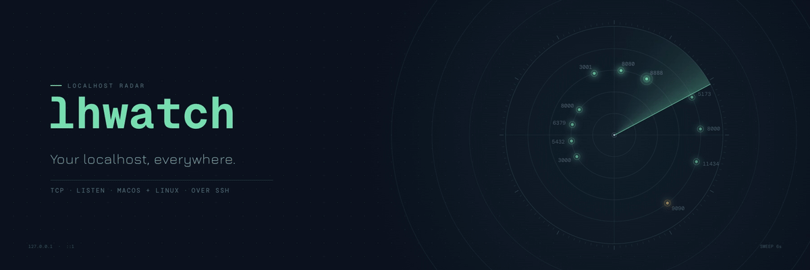

<p align="center">
  <picture>
    <source media="(prefers-reduced-motion: reduce)" srcset="docs/assets/banner.png">
    
  </picture>
</p>

A terminal dashboard for the TCP servers running on your Mac, your Linux machines, and your SSH hosts.

See named services and their ports, filter across machines, inspect a process, and request a graceful stop without switching terminals. Each host refreshes independently, and a disconnected machine stays visibly disconnected.


## Requirements

- **Python 3.9+** (`python3`) on every monitored machine, local and SSH. lhwatch runs a short-lived collector there; nothing is installed.
- **macOS** hosts use the system `lsof` and `ps`. **Linux** hosts use `/proc`.
- **Remote hosts** are reached with your existing OpenSSH client, keys, agent, and SSH configuration.
- **Go 1.26+** only to build from source or run `go install`. Release binaries are static and need nothing beyond a terminal.

## Install

**From a release.** Download the archive for your platform from the repository's **Releases** page, or use the GitHub CLI:

```sh
gh release download --repo joeynyc/lhwatch --pattern '*darwin_arm64.tar.gz' --pattern SHA256SUMS
shasum -a 256 --check --ignore-missing SHA256SUMS
```

Extract the archive and move `lhwatch` onto your `PATH`.

- Archives are published for `darwin_arm64`, `darwin_amd64`, `linux_arm64`, and `linux_amd64`. ARM64 Linux machines such as an NVIDIA DGX Spark use `linux_arm64`.
- If `gh` isn't installed on a machine, download the archive elsewhere and copy it over with `scp`.
- Releases are not code-signed. A binary downloaded through a browser on macOS may need `xattr -d com.apple.quarantine lhwatch`.

**With Go:**

```sh
go install github.com/joeynyc/lhwatch@latest
```

**From source:**

```sh
git clone https://github.com/joeynyc/lhwatch && cd lhwatch && go build -trimpath -o bin/lhwatch .
./bin/lhwatch
```

The examples below assume `lhwatch` is on your `PATH`. Use `./bin/lhwatch` if you built from source.

## Quick start

**Try the demo.** The built-in fleet is entirely simulated, including stop actions. It ignores host configuration and never contacts or signals real services.

```sh
lhwatch --demo
```

**Add an SSH host.** Connect once with `ssh` so your key and the server's identity are known, then name the host:

```sh
ssh you@devbox
lhwatch --host devbox=you@devbox
lhwatch --host devbox=you@devbox --host gpu=you@gpu-box
```

The name before `=` is a dashboard label. The destination can be an existing SSH alias. lhwatch never prompts for a password, accepts an unknown server key, installs a daemon, or changes your SSH configuration. Keep password-protected keys loaded in your SSH agent. See [docs/ssh.md](docs/ssh.md).

**Use a config file.** lhwatch reads `$XDG_CONFIG_HOME/lhwatch/config.json`, or `~/.config/lhwatch/config.json` if that variable is unset. A missing default file is fine.

```json
{
  "refresh_seconds": 3,
  "timeout_seconds": 8,
  "hosts": [
    { "name": "laptop" },
    { "name": "devbox", "ssh": "you@devbox" },
    { "name": "gpu", "ssh": "you@gpu-box", "port": 2222, "identity_file": "~/.ssh/id_ed25519" }
  ]
}
```

A host without `ssh` is the machine running the TUI; if you omit it, one named `local` is added. Order is defaults, then file, then flags, and `--host` entries add to the file's hosts. Host name rules, limits, and flags are in [docs/configuration.md](docs/configuration.md).

## Keys

| Key | Action |
| --- | --- |
| `↑` / `↓`, `k` / `j` | Select a service, or scroll an open panel |
| `Home` / `g`, `End` / `G` | Jump to the first or last service |
| `PgUp` / `PgDn` | Page through an open panel |
| `/` | Search names, commands, hosts, ports, and directories |
| `Backspace` / `Ctrl+U` while searching | Edit or clear the query |
| `Enter` while searching | Keep the filter and return to navigation |
| `Esc` | Cancel a dialog or clear the filter |
| `Tab` / `Shift+Tab` | Cycle host filters |
| `Enter` | Inspect all endpoints, identity evidence, and available actions |
| `o` | Open the service in a browser, through an SSH tunnel for remote hosts |
| `O` | Close the selected service's SSH tunnel |
| `x` | Review a stop confirmation |
| `y` inside confirmation | Request SIGTERM for the displayed process |
| `n`, `q`, `Esc`, or `Enter` inside confirmation | Cancel; no signal |
| `r` | Refresh |
| `e` | Inspect host errors and warnings |
| `?` | Keyboard help |
| `q` / `Ctrl+C` | Quit |

The mouse works too. A click never sends a signal; confirming a stop always needs `y`. Run with `--no-mouse` to let your terminal select text. See [docs/interface.md](docs/interface.md).

## What stop does

Pressing `x` opens a confirmation that names the machine, process, PID, and its known listening endpoints. A port belongs to a process, so stopping it can close all of that process's listeners, not just the highlighted one.


- **SIGTERM only.** There is no automatic SIGKILL or process-tree termination. "Requested" means the signal was sent. A process may ignore it or be restarted by its supervisor.
- **Revalidated first.** Before signaling, the collector rechecks the process's identity, ownership, and selected listener on that machine. It refuses unknown, stale, changed, protected, or foreign-user targets.
- **Containers are never stopped.** Processes in Docker, Podman, containerd, CRI-O, Kubernetes, and LXC containers are recognized and refused. Stop those with their own tooling.
- **Missing evidence means refusal.** Unreadable, ambiguous, or incomplete information disables stopping and records a reason.
- **Lost responses are not guesses.** If a response is lost, the outcome is shown as unknown and the host is refreshed.
- **PID reuse.** Linux uses a pidfd when available to bind the signal to one process incarnation. macOS and fallback Linux signaling keep a small check-to-signal race.

Details, including Docker rechecks, are in [docs/stopping.md](docs/stopping.md).

## JSON output

```sh
lhwatch --json
lhwatch --host devbox=you@devbox --json
lhwatch --demo --json
```

`--json` prints one read-only snapshot. It has no destructive command.

- The output contains `schema_version`, `collected_at`, and an ordered `hosts` array. Each host includes its services, collection time, platform, visibility warnings, and any error.
- A host whose scan failed has an `error` and empty `services`. It omits `collected_at` and `platform` rather than reporting placeholder values.
- One record is kept per endpoint. Optional fields carry container attribution (`container_id`, `container_name`, `container_image`, `visibility_reason`) and purpose evidence (`endpoint_label`, `endpoint_label_source`); they are omitted when unknown.
- Partial visibility is reported through `partial` and warnings.
- Process command lines and paths can contain private information. Review snapshots before sharing them.

| Exit code | Meaning |
| --- | --- |
| `0` | Successful snapshot |
| `1` | Any host failed (other results still appear), or a runtime error |
| `2` | Invalid input, or no interactive terminal |

## Documentation

| Page | Contents |
| --- | --- |
| [docs/naming.md](docs/naming.md) | How project names, container attribution, and endpoint purposes are determined, and how to set your own |
| [docs/ssh.md](docs/ssh.md) | SSH setup, connection sharing and control sockets, tunnels, and opening services in a browser |
| [docs/stopping.md](docs/stopping.md) | Full stop semantics and every refusal case |
| [docs/configuration.md](docs/configuration.md) | Config file rules, flags, and precedence |
| [docs/interface.md](docs/interface.md) | Mouse behavior, text selection, and layout |
| [docs/visibility.md](docs/visibility.md) | What lhwatch can and cannot see |
| [docs/verification.md](docs/verification.md) | Tests, smoke tests, and hardware checks |
| [docs/ci.md](docs/ci.md) | Continuous integration and the release procedure |
| [ARCHITECTURE.md](ARCHITECTURE.md) | How the pieces fit together and which invariants keep stopping safe |
| [SECURITY.md](SECURITY.md) | Reporting security issues |

## Contributing

Bug reports, fixes, and support for more environments are welcome. See [CONTRIBUTING.md](CONTRIBUTING.md) for how to build, test, and submit changes, and [AGENTS.md](AGENTS.md) if you use a coding agent.

lhwatch is built with [Bubble Tea](https://github.com/charmbracelet/bubbletea) and [Lip Gloss](https://github.com/charmbracelet/lipgloss), plus an embedded Python standard-library collector.

## License

MIT. See [LICENSE](LICENSE).
